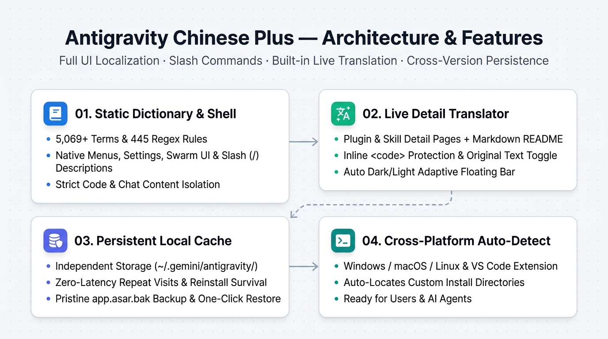
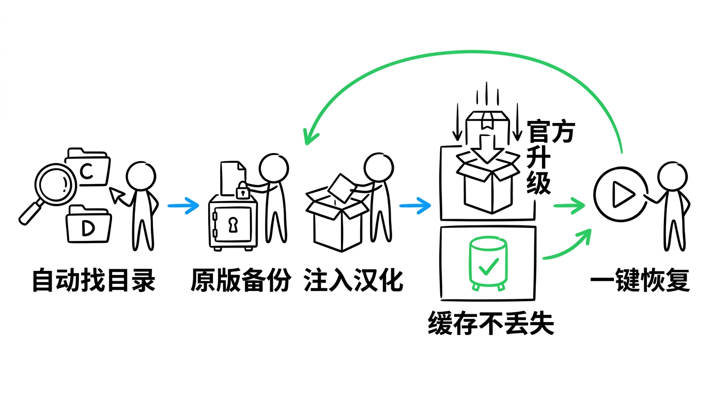

<div align="center">

# Google Antigravity Chinese Plus (Simplified Chinese Localization & Live Translator)

**Targets Antigravity App 2.35.2 & VS Code Extension 1.13.0 · Full UI Dictionary · `/` Slash Command Translations · Built-in Free Google Live Detail Translator**

<p>
  <a href="https://github.com/mitang-ai/antigravity-chinese-plus/actions/workflows/ci.yml"></a>
  
  
  
  
  
  <a href="LICENSE"></a>
</p>

<p>
  <a href="README.md">简体中文（默认）</a> ·
  <a href="README.en.md"><strong>English</strong></a> ·
  <a href="#quick-installation">Quick Install</a> ·
  <a href="#option-2-let-your-ai-agent-install-it">AI Agent Setup</a> ·
  <a href="#faq">FAQ</a>
</p>

</div>

Google Antigravity currently ships without an official Simplified Chinese UI, and marketplace extension details along with built-in slash command descriptions are largely delivered dynamically. This open-source, source-only localization toolkit patches your local desktop client and VS Code extension while keeping a verified pristine backup — combining **5,117 exact UI entries**, **445 pattern rules**, **`/` slash command descriptions**, and a built-in **free Google live translator** with persistent local caching.

> **Source-Only & Privacy-First**: This repository distributes scripts and dictionaries only — never proprietary binaries (`app.asar`), and never collects or transmits user chat messages, credentials, or source code.

<p align="center">
  
</p>

---

## What Problems It Solves

1. **Slash (`/`) command descriptions stayed in English**: Built-in commands (`/goal`, `/compact`, `/schedule`, `/browser`, `/plan`, `/grill-me`, `/teamwork`, `/learn`, `/boost`) and built-in skill tooltips are now covered in the static dictionary, while search-highlight spans are handled cleanly without breaking command names or insertion behavior.
2. **Plugin & skill detail pages load dynamic English Markdown**: Opening marketplace entries such as `Android CLI` renders remote Markdown READMEs and suggested prompts. The built-in live translator handles those scoped detail views automatically while preserving `<pre>` blocks and inline `<code>` tokens via `⟦0⟧` placeholders, plus a light/dark-adaptive floating toggle bar tucked safely in the bottom-right corner to switch between Chinese and the original English at any time.
3. **Zero re-translation overhead across client updates**: Live translations are persisted independently at `~/.gemini/antigravity/i18n-live-cache.json`. When Antigravity updates and replaces `app.asar`, your cached translations remain intact and are picked up immediately once you re-run the installer.

### Localization Scope & Safety Boundaries

| Surface | Mechanism | Scope & Guardrails |
| --- | --- | --- |
| Settings, sidebar, permissions, Swarm UI, onboarding | Static dictionary + pattern rules | 5,117 exact entries & 445 regex patterns |
| `/` slash command popup & built-in skills | Static dict + live fallback | Translates descriptions only; command names, `dir="rtl"` paths & React payloads stay intact |
| Native menus, tray, disconnected & device dialogs | Electron main-process patches | Covers `menu`, `ipcHandlers`, `disconnectedPage`, `deviceChooser`, `signInCallback` |
| Plugin/skill detail pages & Markdown READMEs | Free Google Translate + local cache | Protects `<pre>` and inline `<code>`; adaptive bottom-right bar with one-click Original toggle |
| VS Code extension (1.13.0) | Manifest + local Webview proxy | Separate backup and restore (`node cli.js install:vscode`) |
| **User chat text, Monaco editor, terminals, file trees** | **Strict isolation boundary** | **Never translated, modified, or sent to any external endpoint** |

---

## Quick Installation

Requires **Node.js >= 18** (initial ASAR packing may download `@electron/asar` via npm/npx).

### Option 1: Interactive Local Install

1. Clone or download this source repository:
   ```bash
   git clone https://github.com/mitang-ai/antigravity-chinese-plus.git
   cd antigravity-chinese-plus
   ```
2. **Windows**: Double-click **[`install.bat`](install.bat)** in the repository root.
   - **Auto-locates custom installs**: Automatically checks standard `AppData`/`Program Files` paths, drives `C:` through `F:`, Windows Uninstall registry entries, running process paths, and Desktop/Start Menu shortcuts. If installed in an unusual folder, you can drag and drop the Antigravity folder or shortcut directly into the terminal prompt.
   - If `Antigravity.exe` is still running in the background tray, you can press `Enter` after closing it or type `Y` to let the installer close the residual process cleanly.
3. **macOS / Linux**: Quit Antigravity normally, then run:
   ```bash
   npm install
   bash install.sh
   ```

<a id="option-2-let-your-ai-agent-install-it"></a>

### Option 2: Let Your AI Agent Install It

If you use Antigravity, Claude Code, or Cursor, copy and paste this prompt to your agent (note: running inside an active Antigravity session safely pre-builds `app.asar.staged` without force-killing the host; exit and run `install.bat` or restart to apply):

```text
Please install Google Antigravity Chinese Plus for me:
1. Clone https://github.com/mitang-ai/antigravity-chinese-plus.git into a local folder (or pull the latest if present).
2. Run `npm install` and `node cli.js install --with-plugin` inside the repo (if Antigravity is installed in a non-standard drive/folder and not auto-detected, locate it first and pass `--path "<install dir>"`).
3. Run `node cli.js status` afterward to verify the backup and patch status, and tell me if I need to restart Antigravity.
```

---

## How Backup, Updates & Persistence Work

<p align="center">
  
</p>

Before patching, the installer checks whether `app.asar` is an unpatched upstream binary. Only pristine originals are saved as `app.asar.bak` with a SHA-1 fingerprint (`app.asar.bak.fingerprint`), ensuring an already-patched copy never overwrites your clean restore baseline.

### CLI Reference (`cli.js`)

| Command | Purpose |
| --- | --- |
| `node cli.js install --with-plugin` | Auto-detect desktop app and VS Code extension, install patch + community plugin |
| `node cli.js manual-install` | Interactive installer (multi-drive/registry/shortcut scan, drag-and-drop path & tray exit helper) |
| `node cli.js status` | Show detected path, backup status, live translator cache count & plugin readiness |
| `node cli.js install --path "<dir>"` | Target a specific custom installation folder or `app.asar` file |
| `node cli.js launch` | Self-healing launcher: detects upstream updates and re-applies patches before launch |
| `node cli.js restore` | Restore desktop & VS Code targets back to pristine upstream English |
| `node cli.js install:vscode` / `restore:vscode` | Install or restore only the VS Code extension localization |

---

## FAQ

<details>
<summary><strong>1. Will an official Antigravity update break the localization, and will my translated plugin details be lost?</strong></summary>

Official updates overwrite `app.asar` in the application folder, so you simply re-run `install.bat` (or `node cli.js install`). All previously translated plugin details remain safely stored in `~/.gemini/antigravity/i18n-live-cache.json` and take effect immediately at zero network cost.

</details>

<details>
<summary><strong>2. What if Antigravity is installed on drive D: or a custom path instead of C:?</strong></summary>

`cli.js` automatically scans `C:`–`F:` common folders, Windows registry entries, active process paths, and Desktop/Start Menu `.lnk` shortcuts. You can also pass `--path "<dir>"` or drag the folder into the `install.bat` prompt. On Linux, portable directories under `~/Applications/Portable` and `~/Applications` are checked automatically.

</details>

<details>
<summary><strong>3. Does the built-in Google translator need an API key, or send my private chats/code?</strong></summary>

No API key is needed. The main-process bridge ([live-translate-main.js](core/live-translate-main.js)) uses Electron's `net.fetch` (respecting your system proxy) to query free Google Translate endpoints. The renderer module ([live-translator.js](core/live-translator.js)) strictly limits scope to marketplace plugin details, suggested prompts, and unknown slash command descriptions — your chat messages, Monaco code editor, terminals, and file paths are never accessed or sent.

</details>

---

## Verification, Architecture & Upstream Attribution

- **Verification Summary (Windows x64 · Antigravity App 2.35.2 / 2.35.1 / 2.35.0)**:
  - `npm run build:dict`: Builds **5,117** exact entries and **445** regex rules into [dict/zh-CN.json](dict/zh-CN.json) and [dist/zh-CN.bundle.json](dist/zh-CN.bundle.json).
  - `npm test` (aggregating 15 test suites): Runs syntax lint, golden UI verification, JSDOM user-content isolation, Swarm panel isolation, scan performance benchmarks, ASAR backup/upgrade lifecycle, VS Code proxy patch checks, live-translator unit tests, and persistent guardian/hot-override checks (`test-guardian.js`), followed by 45 static consistency checks in `tools/ultimate-consistency-audit.js`.
  - See [docs/maintenance/antigravity-2.35.0.md](docs/maintenance/antigravity-2.35.0.md) for the 2.35.0 / 2.35.1 inspection baseline. macOS and Linux coverage consists of cross-platform automated regressions; VS Code 1.13.0 was not installed locally for live testing in this round.

```bash
npm run build:dict   # Compile layered dictionaries under dict/src/
npm test             # Run all 15 test suites and consistency audit
npm run audit        # Run the 45-check static consistency audit
```

### Attribution & License

- **Upstream Attribution**: Built upon and extended from the MIT-licensed open-source project [yiheng8023/antigravity-chinese](https://github.com/yiheng8023/antigravity-chinese) and its community contributors (`a705876883-arch`, `fansID512`, `MizuIro-H`, `tangyixiao`, `Qiinn-71`, etc.). This fork/edition adds full Antigravity App `2.35.0–2.35.2` adaptation, built-in `/` slash command localization, the built-in Google live detail translator with persistent caching, multi-drive/registry auto-detection, and the hardened interactive Windows installer.
- **Disclaimer**: Independent community utility, not affiliated with or endorsed by Google LLC.
- **License**: Released under the [MIT License](LICENSE).

---

<div align="center">

[](https://star-history.com/#mitang-ai/antigravity-chinese-plus&Date)

</div>
