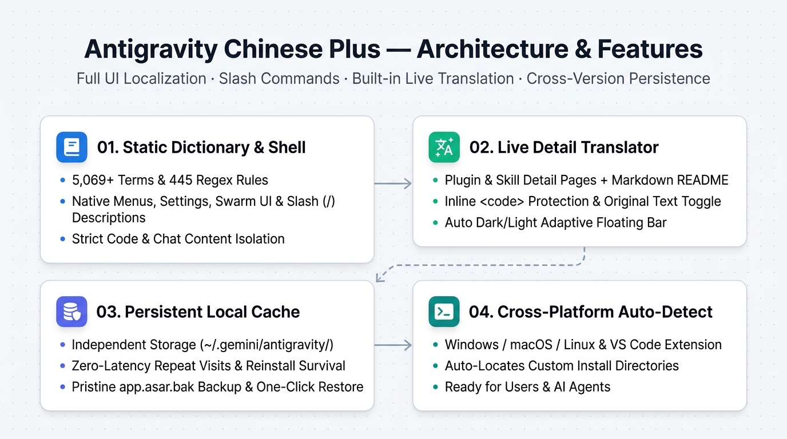
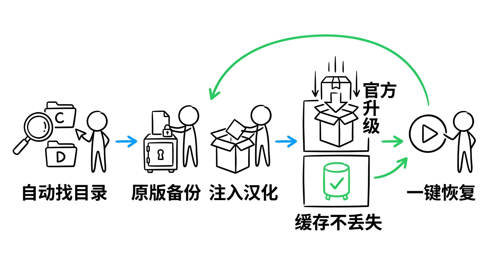

<div align="center">

# Google Antigravity 中文汉化增强版（antigravity-chinese-plus）

**适配 Antigravity App 2.35.0 & VS Code 扩展 1.13.0 · 桌面客户端全界面中文化 · `/` 斜杠指令翻译 · 内置 Google 免费详情页实时翻译**

<p>
  <a href="https://github.com/mitang-ai/antigravity-chinese-plus/actions/workflows/ci.yml"></a>
  
  
  
  
  
  <a href="LICENSE"></a>
</p>

<p>
  <a href="README.md"><strong>简体中文（默认）</strong></a> ·
  <a href="README.en.md">English</a> ·
  <a href="#快速安装">快速安装</a> ·
  <a href="#交给你的-ai-agent-自动安装">AI Agent 安装指引</a> ·
  <a href="#常见问题-faq">常见问题</a>
</p>

</div>

Google Antigravity（反重力）目前没有官方中文界面，且扩展市场详情页和部分内置指令高度依赖动态下发内容。本项目是一套纯源码分发的本地中文本地化工具：在保留官方原版纯净备份的前提下，为桌面客户端与 VS Code 扩展补齐 **5,092 条**界面词典、**`/` 斜杠指令说明**以及内置的 **Google 免费实时翻译插件**，做到日常使用和点开扩展详情页都能顺畅阅读中文。

> **核心承诺**：本仓库仅提供开源脚本与词库源码，不打包任何官方专有二进制文件，不收集或上传任何用户对话、凭据或代码隐私。

<p align="center">
  
</p>

---

## 为什么做这个增强版？

常规静态词典能覆盖设置面板和按钮，但实机使用 Antigravity 2.35.0 时仍会遇到三类“汉化盲区”：

1. **输入 `/` 呼出斜杠指令时说明仍是英文**：例如 `/goal`、`/compact`、`/schedule`、`/browser`、`/plan`、`/grill-me`、`/teamwork`、`/learn`、`/boost` 及内置技能说明。本项目已将其补齐至静态词典，同时修复了搜索高亮拆分导致的半英半中残片；**命令本身与插入行为完全保持原样**。
2. **点开自定义扩展详情页里全是英文**：例如点击市场里的 `Android CLI` 等插件后，下方的示例提示词和 Markdown README 均为远程或动态拉取。内置的 **Google 实时翻译模块** 会在你打开详情页时自动翻译介绍和示例提示词，利用 `⟦0⟧` 占位符完整保护行内 `<code>` 代码块与 `<pre>` 示例；右下角提供 **深/浅色自适应悬浮条**，不遮挡顶栏「打开 IDE」按钮，可一键切回英文原文。
3. **客户端更新后不想一切重来**：在线翻译结果会持久化缓存至 `~/.gemini/antigravity/i18n-live-cache.json`，与 Antigravity 安装目录彻底隔离。即使官方推送新版覆盖客户端，旧缓存依然秒读复用，重跑一次安装命令即可全部恢复。

### 翻译范围与安全边界

| 区域 / 场景 | 处理机制 | 说明与安全约束 |
| --- | --- | --- |
| 设置、侧栏、权限、Swarm 面板、引导页 | 静态精确词典 + 级联正则 | 5,092 条词条与 445 组正则，命中即毫秒级生效 |
| `/` 斜杠指令菜单与内置技能说明 | 静态词典 + 实时翻译兜底 | 仅翻译右侧说明文字；命令名、路径（`dir="rtl"`）及功能闭包保持原样 |
| 原生菜单、托盘、断连页、设备弹窗 | Electron 主进程壳层补丁 | 覆盖菜单栏、右键菜单、`disconnectedPage`、`deviceChooser`、`signInCallback` 等 |
| 自定义扩展详情页与技能 README | Google 免费实时翻译 + 本地持久化 | 保护 `<pre>` 与行内 `<code>`；支持悬浮条一键「查看原文 / 切回译文」与开关 |
| VS Code 扩展（1.13.0） | 清单翻译 + 本地微代理 | 独立备份与还原；更新扩展后重新执行 `node cli.js install:vscode` |
| **用户对话正文、Monaco 代码、终端、文件树** | **严格白名单隔离保护** | **绝不翻译、绝不篡改、绝不外发任何代码或聊天内容** |

---

## 快速安装

前置条件：**Node.js >= 18**（安装器首次重打包 ASAR 时可能需要联网获取 `@electron/asar` 工具）。

### 方式一：自己手动一键安装

1. 克隆或下载本仓库源码：
   ```bash
   git clone https://github.com/mitang-ai/antigravity-chinese-plus.git
   cd antigravity-chinese-plus
   ```
2. **Windows 用户**：直接双击根目录的 **[`install.bat`](install.bat)**。
   - **自动跨盘定位**：无论你的 Antigravity 安装在默认的 `AppData`，还是自定义到了 **C / D / E / F 盘**、修改过安装目录，脚本都会通过多盘符扫描、Windows 注册表卸载信息、运行中进程路径与桌面/开始菜单快捷方式自动定位；若极端路径仍未自动识别，还支持直接把安装文件夹或快捷方式拖进命令行窗口完成安装。
   - 若检测到 `Antigravity.exe` 仍在后台或系统托盘运行，可按提示退出后回车继续，或输入 `Y` 由向导自动结束残留进程并完成原子替换。
3. **macOS / Linux 用户**：保存工作并退出 Antigravity 客户端后，在仓库目录执行：
   ```bash
   npm install
   bash install.sh
   ```

<a id="交给你的-ai-agent-自动安装"></a>

### 方式二：直接交给你的 AI Agent 自动安装

如果你已经在使用 Antigravity、Claude Code、Cursor 或其他具备终端操作能力的编程智能体，可以直接把下面这段指令发给它，让它自行拉取源码并按你的电脑路径安装（注意：如果在 Antigravity 自身对话内运行，安装器会自动进入**无损预注入模式**构建 `app.asar.staged`，退出重启客户端后生效）：

```text
请帮我安装 Google Antigravity 中文汉化增强版：
1. 克隆仓库 https://github.com/mitang-ai/antigravity-chinese-plus.git 到本地合适目录（若已存在则拉取最新）。
2. 进入仓库目录运行 `npm install` 和 `node cli.js install --with-plugin`（若客户端在 D 盘等非默认位置且未自动命中，请先查找本机 Antigravity 安装路径并通过 `--path "<安装目录>"` 指定）。
3. 完成后运行 `node cli.js status` 向我确认备份与安装状态，并在需要重启时提醒我。
```

---

## 工作原理：备份、防覆盖与跨版本持久化

<p align="center">
  
</p>

安装器在修改任何客户端文件前，都会先校验当前 `app.asar` 是否为未修改过的官方原版：只有确认是原生文件时，才会生成 `app.asar.bak` 与 `app.asar.bak.fingerprint`（SHA-1 指纹）。**绝不用打过补丁的包去覆盖纯净备份**。

### 常用命令行工具 (`cli.js`)

| 命令 | 作用说明 |
| --- | --- |
| `node cli.js install --with-plugin` | 自动探测本机桌面客户端与 VS Code 扩展，安装汉化与社区插件 |
| `node cli.js manual-install` | 交互式安装向导（支持多盘符/注册表/快捷方式定位、拖拽路径与托盘进程引导） |
| `node cli.js status` | 查看客户端路径、纯净备份、汉化补丁、实时翻译缓存条数及插件状态 |
| `node cli.js install --path "<目录>"` | 手动指定非标准安装目录或 `app.asar` 文件路径 |
| `node cli.js launch` | 自愈启动：若发现官方刚升级覆盖了补丁，自动重新注入后再拉起客户端 |
| `node cli.js restore` | 一键无损还原为官方英文原版（缺少有效原版备份时会拒绝覆盖以防出错） |
| `node cli.js install:vscode` / `restore:vscode` | 单独安装或还原 VS Code 扩展汉化 |

---

## 常见问题 (FAQ)

<details>
<summary><strong>1. Google Antigravity 官方更新到新版本后，汉化会失效吗？以前翻译过的插件详情还在吗？</strong></summary>

官方客户端升级会覆盖程序目录下的 `app.asar`，属于正常现象。此时你只需要重新运行一次 `install.bat`（或 `node cli.js install`）即可恢复；而你之前看过的插件详情译文保存在独立的用户目录 `~/.gemini/antigravity/i18n-live-cache.json` 中，**不会因为客户端重装或升级而丢失**，重新打开依然秒出中文。

</details>

<details>
<summary><strong>2. 我的 Antigravity 没有装在 C 盘默认位置，安装程序能找到吗？</strong></summary>

可以。Windows 版安装向导除了检查 `AppData\Local\Programs\antigravity` 和 `Program Files` 外，还会自动检索常见盘符（C / D / E / F 盘）、Windows 注册表、当前运行进程路径以及桌面/开始菜单快捷方式的目标路径；即使装在极生僻的目录，也可以通过 `node cli.js install --path "<目录>"` 或直接在 `install.bat` 窗口中拖入文件夹完成安装。Linux 便携解压版同样支持 `~/Applications/Portable` 等目录或通过 `--path` 指定。

</details>

<details>
<summary><strong>3. 内置的 Google 实时翻译需要 API Key 吗？会不会上传我的代码或聊天记录？</strong></summary>

不需要任何 API Key。主进程模块 [live-translate-main.js](core/live-translate-main.js) 通过 Electron `net.fetch` 自动沿用你的系统网络设置访问 Google 免费翻译通道。更重要的是，前端 [live-translator.js](core/live-translator.js) **仅读取扩展详情页介绍、示例提示词和斜杠技能说明**，你的个人对话记录、工作区源码（Monaco 编辑器）、终端日志以及本地文件路径均在严格保护边界内，**绝对不会被读取或发送**。

</details>

<details>
<summary><strong>4. 如果在运行中的 Antigravity 对话里安装，重启后为什么没立即变化？</strong></summary>

由于 Windows 文件锁限制，客户端运行时无法直接替换正在占用的 `app.asar`。在会话内部安装会进入安全无损的 `app.asar.staged` 预构建模式；如果客户端退出后托盘仍有残留或进程切换过快，可能未能完成替换。此时只需要完全退出 Antigravity（留意右下角系统托盘），再双击运行一次 **[`install.bat`](install.bat)** 即可 1 秒完成原子替换。

</details>

<details>
<summary><strong>5. 想要恢复原汁原味的官方英文界面怎么办？</strong></summary>

退出客户端后，运行仓库下的 `uninstall.bat`（Windows）或执行 `node cli.js restore` 即可根据初始纯净备份 `app.asar.bak` 完整恢复，并清理社区全局插件。

</details>

---

## 测试验证、源码结构与开发维护

每次词库更新或引擎修改均可在本仓库本地验证后再发布。

- **当前验证数据（Windows x64 · Antigravity App 2.35.0）**：
  - `npm run build:dict`：编译产出 **5,092** 条精确词条与 **445** 组级联正则（[dict/zh-CN.json](dict/zh-CN.json) & [dist/zh-CN.bundle.json](dist/zh-CN.bundle.json)）。
  - `npm test`（**聚合 14 套自动化测试**）：涵盖语法编译门禁、UI 黄金语义、JSDOM 内容保护边界、Swarm 面板隔离、性能扫描基准、ASAR 升级与断电回滚生命周期、VS Code 微代理补丁，以及 Google 实时翻译与斜杠高亮专项测试，最后串联 `tools/ultimate-consistency-audit.js`（45 项静态一致性检查）。
  - 实机适配依据见 [2.35.0 维护记录](docs/maintenance/antigravity-2.35.0.md)；`macOS`、`Linux` 及 `VS Code` 扩展部分在本轮中的验证范围为跨平台自动化回归与脚本链路核验。

<details>
<summary><strong>点击展开核心目录与开发命令</strong></summary>

```text
antigravity-chinese-plus/
├── cli.js                          # 跨平台安装、多路径探测、备份还原与交互向导
├── install.bat / install.sh        # Windows / macOS / Linux 一键安装入口
├── core/
│   ├── i18n-runtime.js             # 渲染层核心翻译引擎、防误译内容边界与斜杠菜单兼容
│   ├── live-translate-main.js      # 主进程 Google 免费翻译代理与 ~/.gemini 持久化缓存
│   ├── live-translator.js          # 扩展详情页受控实时翻译、代码块保护与自适应悬浮栏
│   ├── swarm-i18n.js               # Swarm 面板隔离翻译引擎
│   └── vscode-patch.js             # VS Code 扩展与 Webview 微代理本地化
├── dict/
│   ├── src/                        # 分层词库源码（core / ctx / rules）
│   └── scoped/                     # Swarm 词库与官方插件短介绍词库
├── plugins/chinese-toolkit/        # 社区中文交互规范插件与维护诊断技能
├── test/                           # 14 套自动化测试入口与 UI 基准夹具
└── tools/                          # 词库构建管线、漂移检测、UI 清单核验与一致性审计
```

```bash
npm run build:dict   # 从 dict/src 编译交付词库
npm test             # 运行全部 14 套自动化测试与一致性审计
npm run audit        # 仅运行 45 项静态一致性体检
```

</details>

---

## 致谢与开源协议

- **上游致谢**：本项目基于开源项目 [yiheng8023/antigravity-chinese](https://github.com/yiheng8023/antigravity-chinese)（MIT License）构建与衍生增强，感谢原项目维护者以及此前提交问题定位与修复的社区贡献者（`a705876883-arch`、`fansID512`、`MizuIro-H`、`tangyixiao` 等）。本仓库在其基础上新增并完善了 Antigravity App `2.35.0` 全量适配、内置 `/` 斜杠指令翻译、内置 Google 免费实时翻译插件与本地永久缓存、多盘符/注册表安装探测及零闪退交互式安装体验。
- **商标与合规声明**：本项目为社区独立维护的开源工具，与 Google LLC 无官方从属关系；`Google`、`Google Antigravity`、`Gemini` 等商标归各自所有者所有。
- **开源协议**：本项目以 [MIT License](LICENSE) 开源发布。

---

<div align="center">

[](https://star-history.com/#mitang-ai/antigravity-chinese-plus&Date)

</div>
